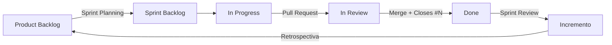
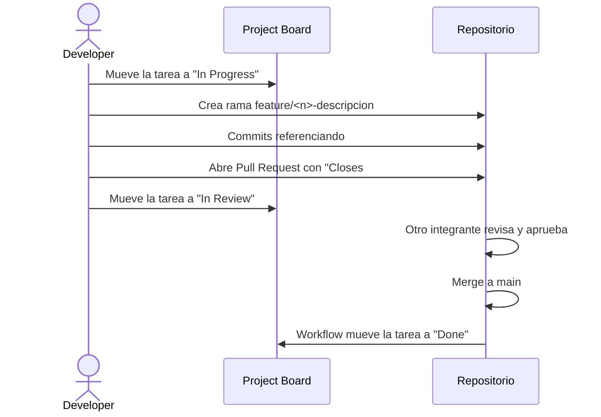

# Laboratorio Gestión de Proyectos Ágiles con Github Projects

**Herramientas:** GitHub (Issues, Projects, Pull Requests), Git  
**Modalidad:** A realizarse con los equipos del curso
**Objetivo:** Configurar y utilizar GitHub Projects para gestionar un proyecto de software siguiendo el marco de trabajo Scrum: Product Backlog, Sprint Planning, Sprint Backlog, seguimiento diario, revisión y retrospectiva.

---

## Conceptos Previos: Scrum en GitHub

Antes de empezar, es importante entender cómo se traducen los artefactos y eventos de Scrum a las funcionalidades de GitHub:

| Scrum | GitHub |
|-------|--------|
| Product Backlog | Vista de tabla del Project con todos los issues sin sprint asignado |
| Historia de usuario (User Story) | Issue creado con una plantilla (issue form) |
| Tareas técnicas de una historia | Sub-issues de la historia |
| Sprint | Campo personalizado de tipo **Iteration** |
| Sprint Backlog | Vista filtrada por el sprint actual (`iteration:@current`) |
| Tablero Scrum (To Do / Doing / Done) | Vista de tipo **Board** agrupada por el campo `Status` |
| Story Points | Campo personalizado de tipo **Number** |
| Prioridad (MoSCoW) | Campo personalizado de tipo **Single select** |
| Incremento | Pull Requests fusionados en `main` que cierran issues |
| Burndown / Burnup | **Insights** del Project |
| Product Owner / Scrum Master / Developers | Roles asignados entre los integrantes del equipo (*assignees*) |



---

## Caso de Estudio: Sistema de Reserva de Salas de Estudio

La biblioteca de la universidad necesita un sistema web sencillo para que los estudiantes puedan reservar salas de estudio grupales. El Product Owner ha identificado las siguientes necesidades iniciales:

1. Los estudiantes deben poder registrarse e iniciar sesión con su correo institucional.
2. Los estudiantes deben poder ver la lista de salas disponibles con su capacidad.
3. Los estudiantes deben poder reservar una sala para una fecha y bloque horario.
4. Los estudiantes deben poder cancelar una reserva propia.
5. Los estudiantes deben poder ver el historial de sus reservas.
6. El personal de la biblioteca debe poder registrar, editar y deshabilitar salas.
7. El personal de la biblioteca debe poder ver las reservas del día.
8. El sistema debe enviar un correo de confirmación cuando se realiza una reserva.
9. El sistema no debe permitir que un estudiante tenga más de 2 reservas activas.
10. El personal de la biblioteca debe poder exportar un reporte mensual de uso de salas.

> **Nota:** En este laboratorio **no se pide implementar el sistema completo**. El foco está en la gestión del proyecto. Solo se pedirá código mínimo para practicar el flujo Issue → Rama → Pull Request → Done.

---

## Preparación

1. Definan los roles del equipo y anótenlos (se incluirán en el `README.md`):
   - **Product Owner (PO):** 1 integrante.
   - **Scrum Master (SM):** 1 integrante.
   - **Developers:** todos los integrantes (incluyendo PO y SM para fines del laboratorio).
2. El **Scrum Master** crea un repositorio **público** en su cuenta llamado `is2-lab04-reservas` con un `README.md`.
3. Agregar a los demás integrantes como colaboradores: **Settings → Collaborators → Add people**.
4. Todos los integrantes clonan el repositorio:

```bash
git clone git@github.com:<usuario-sm>/is2-lab04-reservas.git
cd is2-lab04-reservas
```

---

## Ejercicio 1: Plantillas de Issues para Historias de Usuario

Para que todas las historias de usuario tengan el mismo formato, crearemos **issue forms** (plantillas en YAML).

### 1) Crear la plantilla de Historia de Usuario

Crear el archivo `.github/ISSUE_TEMPLATE/historia-usuario.yml`:

```yaml
name: Historia de Usuario
description: Nueva historia de usuario para el Product Backlog
title: "[HU] "
labels: ["historia-usuario"]
body:
  - type: input
    id: rol
    attributes:
      label: Como...
      description: Rol del usuario
      placeholder: estudiante
    validations:
      required: true
  - type: input
    id: accion
    attributes:
      label: Quiero...
      description: Funcionalidad que se necesita
      placeholder: reservar una sala de estudio
    validations:
      required: true
  - type: input
    id: beneficio
    attributes:
      label: Para...
      description: Beneficio o valor que obtiene el usuario
      placeholder: asegurar un espacio para estudiar con mi grupo
    validations:
      required: true
  - type: textarea
    id: criterios
    attributes:
      label: Criterios de aceptación
      description: Usar el formato Dado / Cuando / Entonces
      value: |
        - [ ] **Dado** ... **cuando** ... **entonces** ...
        - [ ] **Dado** ... **cuando** ... **entonces** ...
    validations:
      required: true
  - type: textarea
    id: notas
    attributes:
      label: Notas adicionales
      description: Información técnica, mockups, dependencias, etc.
```

### 2) Crear la plantilla de Bug

Crear el archivo `.github/ISSUE_TEMPLATE/bug.yml`:

```yaml
name: Bug
description: Reportar un defecto encontrado
title: "[BUG] "
labels: ["bug"]
body:
  - type: textarea
    id: descripcion
    attributes:
      label: Descripción
      description: ¿Qué está pasando?
    validations:
      required: true
  - type: textarea
    id: pasos
    attributes:
      label: Pasos para reproducir
      value: |
        1.
        2.
        3.
    validations:
      required: true
  - type: textarea
    id: esperado
    attributes:
      label: Comportamiento esperado
    validations:
      required: true
```

### 3) Crear la plantilla de Pull Request

Crear el archivo `.github/pull_request_template.md`:

```markdown
## Descripción
<!-- ¿Qué cambia este PR? -->

## Issue relacionado
Closes #

## Checklist (Definition of Done)
- [ ] El código compila y se ejecuta sin errores
- [ ] Se cumplen los criterios de aceptación de la historia
- [ ] Se agregaron/actualizaron pruebas
- [ ] Al menos un integrante revisó el PR
```

### 4) Subir los cambios

```bash
git add .github
git commit -m "Agregar plantillas de issues y pull request"
git push origin main
```

### 5) Crear las etiquetas (labels)

En el repositorio ir a **Issues → Labels** y crear las siguientes etiquetas (la etiqueta `bug` ya existe por defecto):

| Label | Uso |
|-------|-----|
| `historia-usuario` | Historias de usuario del Product Backlog |
| `tarea` | Tareas técnicas (sub-issues) |
| `spike` | Investigación técnica con tiempo limitado |
| `frontend` | Trabajo de interfaz |
| `backend` | Trabajo de servidor / base de datos |

**Verificación:** Ir a **Issues → New issue** y comprobar que aparecen las plantillas *Historia de Usuario* y *Bug*.

---

## Ejercicio 2: Crear y Configurar el GitHub Project

### 1) Crear el Project

1. Ir al perfil del Scrum Master → pestaña **Projects** → **New project**.
2. Seleccionar la plantilla **Team planning** (o *Board* si no aparece) y nombrarlo `Lab04 - Reservas de Salas`.
3. Dentro del Project, ir a **⋯ → Settings → Manage access** y agregar a todos los integrantes con rol **Write** (o **Admin**).
4. Vincular el Project al repositorio: en el repositorio, pestaña **Projects → Link a project** y seleccionar `Lab04 - Reservas de Salas`.

### 2) Configurar el campo `Status`

En **Settings → Status** (o editando las columnas del tablero), dejar exactamente estas opciones y en este orden:

| Opción | Significado en Scrum |
|--------|----------------------|
| `Product Backlog` | Ítems refinados o por refinar, sin sprint asignado |
| `Sprint Backlog` | Comprometidos para el sprint, aún no iniciados |
| `In Progress` | Alguien está trabajando en el ítem |
| `In Review` | Hay un Pull Request abierto esperando revisión |
| `Done` | Cumple la Definition of Done |

### 3) Crear los campos personalizados

En **Settings → Custom fields → New field** crear:

| Campo | Tipo | Configuración |
|-------|------|---------------|
| `Sprint` | **Iteration** | Duración: **1 semana**. Fecha de inicio: hoy. Crear **3** iteraciones (Sprint 1, Sprint 2, Sprint 3). |
| `Story Points` | **Number** | — |
| `Prioridad` | **Single select** | `Must have`, `Should have`, `Could have`, `Won't have` |
| `Tipo` | **Single select** | `Historia`, `Tarea`, `Bug`, `Spike` |

> **Nota:** Si la plantilla ya creó campos similares (por ejemplo `Iteration`, `Size`, `Estimate` o `Priority`), pueden renombrarlos o eliminarlos para que el Project quede únicamente con los campos de la tabla.

> **Tip:** Las iteraciones en GitHub Projects permiten agregar **breaks** (pausas) entre sprints, por ejemplo para semanas de exámenes.

### 4) Activar los Workflows automáticos

En **⋯ → Workflows** activar y configurar:

| Workflow | Configuración |
|----------|---------------|
| **Item added to project** | Establecer `Status` = `Product Backlog` |
| **Item closed** | Establecer `Status` = `Done` |
| **Pull request merged** | Establecer `Status` = `Done` |
| **Item reopened** | Establecer `Status` = `In Progress` |
| **Auto-add to project** | Filtro: `is:issue,pr is:open` para el repositorio `is2-lab04-reservas` |

**Verificación:** Crear un issue de prueba en el repositorio y comprobar que aparece automáticamente en el Project con estado `Product Backlog`. Luego cerrarlo y verificar que pasa a `Done`. Finalmente eliminar el issue de prueba.

---

## Ejercicio 3: Construir el Product Backlog (Rol: Product Owner)

### 1) Redactar las historias de usuario

El **Product Owner** (con apoyo del equipo) crea **10 issues** usando la plantilla *Historia de Usuario*, uno por cada necesidad del caso de estudio. Ejemplo para la necesidad 3:

> **Título:** `[HU] Reservar una sala de estudio`
>
> **Como...** estudiante
> **Quiero...** reservar una sala para una fecha y un bloque horario
> **Para...** asegurar un espacio de estudio para mi grupo
>
> **Criterios de aceptación:**
> - [ ] **Dado** que la sala está libre en el bloque elegido, **cuando** confirmo la reserva, **entonces** la reserva queda registrada y la sala aparece ocupada.
> - [ ] **Dado** que la sala ya está ocupada en ese bloque, **cuando** intento reservar, **entonces** el sistema muestra un mensaje de error.
> - [ ] **Dado** que ya tengo 2 reservas activas, **cuando** intento reservar, **entonces** el sistema rechaza la reserva.

Las historias deben cumplir el criterio **INVEST** (Independiente, Negociable, Valiosa, Estimable, Pequeña, Testeable).

### 2) Priorizar el Backlog

1. En el Project, crear una vista de tipo **Table** llamada `Product Backlog`.
2. Mostrar las columnas: `Title`, `Status`, `Prioridad`, `Story Points`, `Sprint`, `Assignees`, `Labels`.
3. Asignar `Tipo` = `Historia` y una `Prioridad` (MoSCoW) a cada historia.
4. Configurar la vista: **Sort by** → `Prioridad` (ascendente) y **Filter** → `-status:Done`.
5. Dentro de cada prioridad, **arrastrar las filas** para ordenar manualmente el backlog según el valor para el negocio.
6. Guardar la vista (**Save changes**).

### 3) Estimar con Planning Poker

1. Todo el equipo estima cada historia usando la serie de Fibonacci: `1, 2, 3, 5, 8, 13`.
2. Pueden usar cartas físicas o una herramienta online gratuita de *planning poker*.
3. Si la estimación de alguna historia es **13 o más**, la historia es demasiado grande: deben **dividirla** en dos o más historias más pequeñas (cerrar la original como *not planned* y crear las nuevas).
4. Registrar el valor en el campo `Story Points`.

> **Pregunta (responder en el README):** ¿Qué historias tuvieron mayor diferencia de estimación entre los integrantes? ¿Por qué creen que ocurrió?

---

## Ejercicio 4: Sprint Planning

### 1) Definir el Sprint Goal y la capacidad

1. Definir la **capacidad** del equipo para el Sprint 1 (por ejemplo: 4 integrantes × 4 puntos = 16 puntos).
2. Redactar un **Sprint Goal** de una línea. Ejemplo: *"Un estudiante puede ver las salas disponibles y realizar una reserva."*
3. Crear un **Milestone** en el repositorio (**Issues → Milestones → New milestone**) llamado `Sprint 1` cuya descripción sea el Sprint Goal y cuya fecha límite coincida con el fin de la iteración.

### 2) Seleccionar las historias del Sprint

1. Desde la vista `Product Backlog`, seleccionar las historias de mayor prioridad cuya suma de `Story Points` no supere la capacidad.
2. A esas historias asignarles: `Sprint` = `Sprint 1`, `Status` = `Sprint Backlog` y Milestone = `Sprint 1`.

> **Tip:** Pueden seleccionar varias filas a la vez en la vista de tabla y editar el campo `Sprint` en bloque.

### 3) Descomponer en tareas (sub-issues)

Para cada historia del Sprint 1:

1. Abrir el issue y en la sección **Sub-issues** usar **Create sub-issue** para crear las tareas técnicas. Ejemplo para `[HU] Reservar una sala de estudio`:
   - `Diseñar modelo de datos de Reserva`
   - `Implementar endpoint POST /reservas`
   - `Validar máximo 2 reservas activas`
   - `Crear formulario de reserva`
   - `Pruebas unitarias del servicio de reservas`
2. A cada sub-issue asignarle la etiqueta `tarea`, `Tipo` = `Tarea`, el mismo `Sprint` y **un responsable** (*assignee*).
3. Verificar que la historia muestra la barra de progreso de sus sub-issues.

### 4) Crear la vista Sprint Board

1. Crear una nueva vista de tipo **Board** llamada `Sprint Actual`.
2. **Column by:** `Status`.
3. **Filter:** `sprint:@current`.
4. En **Fields**, mostrar `Story Points`, `Assignees`, `Prioridad` y `Sub-issues progress`.
5. Activar **Field sum** sobre `Story Points` para ver el total de puntos por columna.
6. (Opcional) Configurar un **límite WIP** en la columna `In Progress` (por ejemplo, igual al número de integrantes).
7. Guardar la vista.

### 5) Crear la vista Roadmap

1. Crear una vista de tipo **Roadmap** llamada `Roadmap`.
2. Configurar **Date fields** → `Sprint`.
3. **Group by:** `Prioridad`.
4. Asignar `Sprint 2` y `Sprint 3` a las historias restantes según su prioridad y observar cómo se visualiza la planificación del release.

### 6) Vista personal "Mis tareas"

Crear una vista de tipo **Table** llamada `Mis tareas` con el filtro `assignee:@me -status:Done`. Cada integrante debe poder ver solo su trabajo pendiente.

---

## Ejercicio 5: Ejecución del Sprint (Rol: Developers)

En este ejercicio cada integrante debe completar **al menos un ciclo completo** de una tarea siguiendo el flujo de trabajo del equipo.

### 1) Flujo de trabajo por tarea



### 2) Pasos

1. Elegir una tarea del Sprint 1 asignada a ti y moverla a `In Progress` en el tablero `Sprint Actual`.
2. Crear una rama desde el issue: en el panel derecho del issue, **Development → Create a branch**, o desde la terminal:

```bash
git checkout main
git pull
git checkout -b feature/12-endpoint-reservas
```

3. Realizar un cambio mínimo relacionado con la tarea (por ejemplo, crear la clase `Reserva.java`, un archivo `docs/modelo-datos.md`, un test, etc.) y hacer commit referenciando el issue:

```bash
git add .
git commit -m "Agregar clase Reserva (#12)"
git push -u origin feature/12-endpoint-reservas
```

4. Abrir un **Pull Request** hacia `main`. Completar la plantilla e indicar `Closes #12` en la sección *Issue relacionado*.
5. Mover la tarea a `In Review`.
6. **Otro integrante** debe revisar el PR, dejar al menos **un comentario** y aprobarlo (**Review changes → Approve**).
7. Hacer **merge** del PR. Verificar que:
   - El issue `#12` se cerró automáticamente.
   - La tarea pasó a `Done` en el tablero gracias al workflow.
   - La historia padre actualizó su barra de progreso de sub-issues.
8. Cuando **todas** las sub-issues de una historia estén cerradas y se cumplan sus criterios de aceptación, el PO marca los checkboxes de los criterios y cierra la historia.

### 3) Proteger la rama `main` (Scrum Master)

Para asegurar la *Definition of Done*, el Scrum Master configura en **Settings → Branches → Add branch ruleset** (o *Branch protection rule*) para `main`:

- [x] Require a pull request before merging
- [x] Require approvals: **1**

A partir de este momento nadie puede hacer push directo a `main`.

### 4) Registrar un bug

Uno de los integrantes reporta un bug ficticio usando la plantilla *Bug* (por ejemplo: *"Se permite reservar una sala en una fecha pasada"*). El PO decide si entra al sprint actual o se queda en el Product Backlog, y le asigna `Tipo` = `Bug` y una `Prioridad`.

### 5) Daily Scrum

Realizar al menos **2 Daily Scrum** (pueden ser simulados en la sesión de laboratorio, de 5 minutos cada uno) usando el tablero `Sprint Actual` como apoyo. Registrar cada daily como un comentario en un issue llamado `Daily Scrum - Sprint 1` con el formato:

```markdown
**Fecha:** 2026-10-02

| Integrante | ¿Qué hice? | ¿Qué haré? | ¿Impedimentos? |
|------------|------------|------------|----------------|
| Ana        | #12        | #13        | Ninguno        |
| Luis       | #15        | #15        | Duda con el modelo de datos |
```

---

## Ejercicio 6: Seguimiento con Insights

1. En el Project, ir a **Insights** (ícono de gráfico en la parte superior).
2. Crear un nuevo gráfico **Burn up** (gráfico por defecto) y filtrarlo por `sprint:"Sprint 1"`. Observar el trabajo total vs. completado.
3. Crear un gráfico adicional:
   - **Layout:** `Stacked bar`
   - **X-axis:** `Assignees`
   - **Group by:** `Status`
   - **Y-axis:** `Sum of Story Points`
   - Nombre: `Carga por integrante`
4. Crear un tercer gráfico:
   - **Layout:** `Column`
   - **X-axis:** `Sprint`
   - **Y-axis:** `Sum of Story Points`
   - **Filter:** `status:Done`
   - Nombre: `Velocidad del equipo`
5. Tomar capturas de pantalla de los tres gráficos.

> **Pregunta (responder en el README):** Según el gráfico de burn up, ¿el equipo logrará cumplir el Sprint Goal? ¿Qué acciones tomarían si no?

---

## Ejercicio 7: Sprint Review y Retrospectiva

### 1) Sprint Review

1. Filtrar el tablero con `sprint:"Sprint 1" status:Done` y presentar al PO lo completado.
2. El PO acepta o rechaza cada historia según sus criterios de aceptación.
3. Las historias **no terminadas** deben volver al Product Backlog: cambiar `Sprint` a `Sprint 2` (o dejarlo vacío) y `Status` a `Product Backlog` o `Sprint Backlog` según corresponda. **Nunca** se marcan como `Done` si no cumplen la Definition of Done.
4. Cerrar el milestone `Sprint 1`.

### 2) Retrospectiva

1. Crear un issue llamado `Retrospectiva - Sprint 1` con la siguiente estructura (formato *Start / Stop / Continue*):

```markdown
## 🟢 Empezar a hacer (Start)
-

## 🔴 Dejar de hacer (Stop)
-

## 🔵 Seguir haciendo (Continue)
-

## Acciones de mejora para el Sprint 2
- [ ] Acción 1 — Responsable: @usuario
- [ ] Acción 2 — Responsable: @usuario
```

2. Cada integrante agrega al menos un punto en cada sección (pueden usar comentarios y luego el SM consolida en el cuerpo del issue).
3. Las **acciones de mejora** se convierten en sub-issues del issue de retrospectiva y se asignan al `Sprint 2`.

### 3) Refinamiento del Backlog (Backlog Refinement)

Revisar las historias del Sprint 2: verificar que tengan criterios de aceptación claros, estimación actualizada y, si es necesario, dividirlas. Cambiar su estado a `Sprint Backlog` cuando estén listas.

---

## Ejercicio 8 (Opcional): Automatizar con GitHub CLI

El CLI `gh` permite gestionar Projects desde la terminal. Primero otorgar el permiso `project` al token:

```bash
gh auth refresh -s project
```

Listar los projects del usuario y obtener su número:

```bash
gh project list --owner @me
```

Crear una historia de usuario y agregarla al Project en un solo paso:

```bash
gh issue create \
  --repo <usuario-sm>/is2-lab04-reservas \
  --title "[HU] Exportar reporte mensual en CSV" \
  --label historia-usuario \
  --body "Como personal de biblioteca quiero exportar un reporte mensual en CSV para analizar el uso de salas." \
  --project "Lab04 - Reservas de Salas"
```

Ver los ítems del Project en formato JSON:

```bash
gh project item-list <numero-project> --owner <usuario-sm> --format json --limit 100
```

**Reto:** Escribir un script (`scripts/backlog.sh`) que lea un archivo `backlog.csv` con columnas `titulo,como,quiero,para` y cree un issue por cada línea agregándolo al Project.

---

## Entregables

Ninguno para este laboratorio, pero deberán hacer lo mismo para su proyecto del curso. Se calificará en la entrega la gestión del proyecto.

---

## Referencias

- [Documentación de GitHub Projects](https://docs.github.com/es/issues/planning-and-tracking-with-projects)
- [Sintaxis de issue forms](https://docs.github.com/es/communities/using-templates-to-encourage-useful-issues-and-pull-requests/syntax-for-issue-forms)
- [Vincular un PR a un issue con palabras clave](https://docs.github.com/es/issues/tracking-your-work-with-issues/using-issues/linking-a-pull-request-to-an-issue)
- [Sub-issues](https://docs.github.com/es/issues/tracking-your-work-with-issues/using-issues/adding-sub-issues)
- [Guía de Scrum (Scrum Guide 2020)](https://scrumguides.org/docs/scrumguide/v2020/2020-Scrum-Guide-Spanish-European.pdf)
