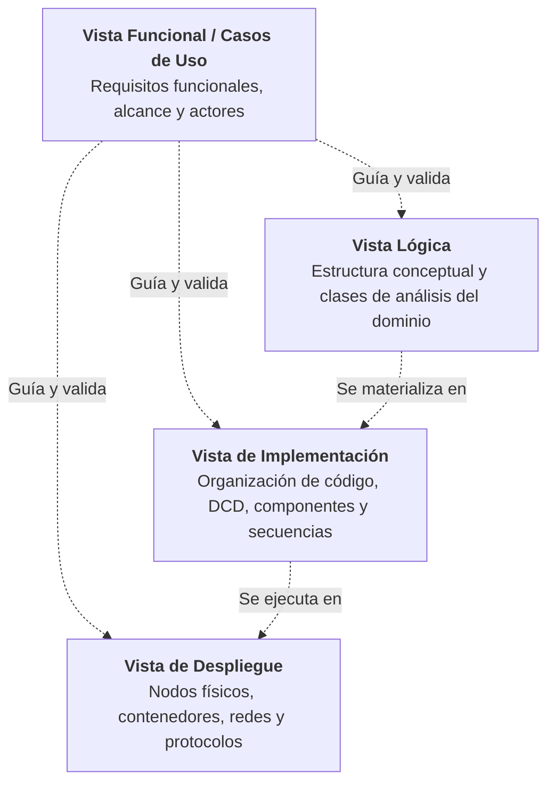

# Laboratorio 06: Arquitectura y Diseño Orientado a Objetos

**Asignatura:** Ingeniería de Software II  
**Herramientas:** Herramienta de modelado (draw.io, PlantUML, Mermaid, Lucidchart o Enterprise Architect), editor Markdown / papel y pizarra para dinámicas de *role-playing*.  

**Modalidad:** Individual

**Objetivo General:** Desarrollar habilidades de análisis, diseño orientado a objetos y documentación arquitectónica mediante el uso de tarjetas CRC, diagramas UML (clases de análisis y diseño, secuencias, componentes y despliegue) y el modelo de vistas 4+1, a partir de requisitos arquitectónicamente significativos (ASR) en sistemas de alta demanda.

---

## Ejercicio 1: Modelado de Dominio y Realización de Requisitos Arquitectónicos (Plataforma FlashBite)

### 1. Contexto del Sistema: "FlashBite" (Plataforma On-Demand Food Delivery)

**FlashBite** es una plataforma tecnológica hiperlocal de entrega de comida y artículos de conveniencia bajo demanda (similar a *DoorDash*, *Rappi* o *Uber Eats*). Su propuesta de valor se basa en conectar en tiempo real a cuatro actores principales: **Clientes**, **Restaurantes Aliados**, **Repartidores Independientes (Couriers/Riders)** y **Operadores de Soporte**.

#### Problemática y Desafíos del Negocio
A diferencia del comercio electrónico tradicional, el negocio de FlashBite es altamente sensible al tiempo, con ventanas de entrega objetivo de entre 25 y 45 minutos. Durante los picos de demanda (almuerzos de 12:30 a 14:30 y cenas de 19:30 a 22:00), la plataforma experimenta:

1. **Flujos transaccionales críticos:** Cientos de carritos se liquidan en simultáneo, exigiendo consistencia en cobros, verificación de cartas y generación de pedidos.
2. **Asignación geoespacial dinámica:** Necesidad de coordinar algoritmos de despacho que emparejen órdenes con repartidores en movimiento optimizando distancias y tiempos de espera en cocina.
3. **Telemetría continua:** Seguimiento satelital en vivo con miles de dispositivos móviles transmitiendo coordenadas GPS cada pocos segundos.
4. **Inventario volátil y concurrente:** Platos populares que se agotan súbitamente durante promociones flash, exigiendo invalidaciones inmediatas en las aplicaciones de los usuarios para evitar ventas de ítems inexistentes.

Para abordar estos retos sin generar una arquitectura monolítica frágil ni sobreingeniería innecesaria, el equipo de arquitectura ha priorizado el modelado detallado de los componentes de dominio y el análisis riguroso de los **Requisitos Arquitectónicamente Significativos (ASR)**.

---

### 2. Historias de Usuario Arquitectónicamente Significativas (ASRs)

A continuación se presentan las 4 historias de usuario priorizadas por su impacto estructural, técnico y de atributos de calidad en la plataforma:

---

#### HU01: Checkout y Creación de Pedido con Múltiples Ítems y Cobro

* **Como** cliente registrado en la aplicación,
* **quiero** confirmar mi carrito con platos de un restaurante específico, calcular el subtotal junto a la tarifa de entrega y procesar el cobro correspondiente,
* **para** que mi orden sea creada formalmente y transmitida a la cocina del restaurante para su preparación.

**Criterios de Aceptación:**

1. **Restricción de origen único:** Todos los ítems agregados deben pertenecer a un único restaurante asociado que se encuentre en estado `ABIERTO`.
2. **Cálculo de montos:** El sistema debe calcular el subtotal acumulando el precio unitario y cantidad de cada ítem, sumar la tarifa de envío del restaurante y determinar el monto total a pagar.
3. **Autorización financiera:** Antes de registrar el pedido en firme, el sistema debe solicitar la autorización del cobro al medio de pago seleccionado.
4. **Creación del pedido:** Si el cobro es exitoso, el pedido pasa a estado `CONFIRMADO`, registrándose la fecha/hora, los ítems seleccionados, el comprobante de pago y el cliente asociado. Si el cobro falla, el pedido no se crea y se informa el motivo al cliente.

**Justificación de Relevancia Arquitectónica:**
Es el núcleo generador de ingresos de la empresa (*core transaction*). Requiere acoplar de forma limpia la consistencia del pedido, la validación del comercio y la interoperabilidad con pasarelas de pago, evitando órdenes "fantasma" o cobros sin pedido registrado.

---

#### HU02: Despacho y Asignación Automatizada a Repartidores Cercanos (Geo-Matching)
* **Como** motor de despacho automatizado,
* **quiero** identificar repartidores disponibles dentro de un radio geográfico óptimo y enviar una oferta de entrega con un temporizador de cuenta regresiva,
* **para** asegurar que un repartidor acepte la orden y viaje al restaurante minimizando el tiempo de espera de la comida en mostrador.

**Criterios de Aceptación:**

1. **Filtrado geoespacial:** El sistema consulta las posiciones geográficas de los repartidores con estado `DISPONIBLE` en un radio inicial de 3 km del restaurante.
2. **Oferta exclusiva temporizada:** El pedido se ofrece al repartidor con mejor puntuación de proximidad y disponibilidad, otorgándole exactamente 30 segundos para aceptar o rechazar.
3. **Control de concurrencia:** Dos repartidores no pueden recibir la oferta exclusiva del mismo pedido al mismo tiempo. Si el candidato rechaza o expira el tiempo, la oferta pasa al siguiente candidato en la cola sin bloquear al sistema.

**Justificación de Relevancia Arquitectónica:**
Impacta directamente en los atributos de **rendimiento (latencia)**, **concurrencia masiva** y **escalabilidad**. Requiere el uso de estructuras de datos en memoria para geolocalización (ej. Redis GEO / Geospatial Indexes), colas de mensajes de alta velocidad y mecanismos de bloqueo optimista/arrendamiento temporal (*lease*) para evitar condiciones de carrera entre repartidores.

---

#### HU03: Telemetría y Rastreo en Tiempo Real de la Ruta del Repartidor (Live Tracking)
* **Como** cliente con un pedido despachado en camino,
* **quiero** observar en un mapa interactivo el desplazamiento en vivo del repartidor y ver el tiempo estimado de llegada (ETA) actualizado,
* **para** tener certidumbre del arribo de mi comida y planificar la recepción en mi puerta.

**Criterios de Aceptación:**

1. **Frecuencia de emisión:** La app del repartidor envía sus coordenadas geográficas (latitud, longitud, velocidad) cada 4 segundos mientras tenga un pedido en curso.
2. **Distribución de baja latencia:** El cliente debe visualizar la posición actualizada del repartidor con un desfase (lag) menor a 1.5 segundos respecto a la emisión.
3. **Cálculo dinámico de ETA:** Si el repartidor se desvía o el servicio de tráfico detecta congestión severa, el ETA debe recalcularse y reflejarse de inmediato en la pantalla del cliente.

**Justificación de Relevancia Arquitectónica:**
Impone un régimen de **streaming de datos de alta frecuencia** y alta concurrencia. Una arquitectura HTTP tradicional colapsaría ante miles de peticiones periódicas por segundo. Se requieren protocolos bidireccionales y livianos (WebSockets, SSE o gRPC) y una arquitectura orientada a eventos (EDA) desacoplada de la base de datos relacional para no degradar el rendimiento operativo.

---

#### HU04: Control Concurrente de Inventario Crítico y Suspensión Temporal de Restaurante
* **Como** encargado de restaurante,
* **quiero** suspender temporalmente la recepción de pedidos ("modo saturado") o marcar platos agotados en un solo toque,
* **para** evitar que clientes ordenen productos no disponibles o se generen retrasos inaceptables en horas pico.

**Criterios de Aceptación:**

1. **Invalidación reactiva:** Al marcar un plato como "Agotado", ninguna orden nueva que contenga dicho plato debe poder ingresar a checkout.
2. **Manejo de pedidos en vuelo:** Si un cliente ya tenía el ítem en su carrito pero no había pagado, el sistema debe advertirle en el checkout y bloquear el pago de ese producto específico.
3. **Tiempo de propagación:** La actualización de disponibilidad en la carta visible para los clientes debe propagarse en un tiempo menor a 1 segundo para miles de usuarios activos navegando en la zona.

**Justificación de Relevancia Arquitectónica:**
Afecta la **disponibilidad**, **consistencia de datos** y **gestión de caché distribuida**. Exige estrategias de invalidación de caché en capas periféricas (CDNs, cachés locales de aplicación, Redis) y control de concurrencia (pesimista vs. optimista) al momento de validar el carrito previo al cobro.

---

### 3. Tareas a Desarrollar

---

#### Tarea 1: Tarjetas CRC (HU01 - Máximo 5 Entidades)

A partir de la **HU01 (Checkout y Creación de Pedido)**, identifiquen las clases conceptuales que participan en el cumplimiento de la historia. Para mantener el modelo enfocado y con alta cohesión, el alcance está estrictamente limitado a un **máximo de 5 entidades de dominio**:

1. `Cliente`
2. `Restaurante`
3. `Pedido`
4. `ItemPedido`
5. `Pago`

##### Formato estándar de Tarjeta CRC:
```
+---------------------------------------------------------------+
| Clase: NombreDeLaClase                                        |
+-------------------------------------+-------------------------+
| Responsabilidades                   | Colaboradores           |
+-------------------------------------+-------------------------+
| [Saber / Hacer]                     | [Clase con la que       |
|                                     |  interactúa]            |
+-------------------------------------+-------------------------+
```

##### Se pide:
1. **Elaborar las 5 tarjetas CRC** definiendo con precisión:
   - **Responsabilidades de tipo "Saber":** Datos o estado que la clase custodia.
   - **Responsabilidades de tipo "Hacer":** Comportamientos, cálculos o validaciones que ejecuta.
   - **Colaboradores:** Otras clases del grupo de 5 a las que debe solicitar información o delegar tareas.
2. **Diagrama de Colaboraciones CRC:** Presentar un esquema visual que muestre la disposición de las 5 tarjetas y las conexiones de colaboración entre ellas.

---

#### Tarea 2: Diagrama de Clases de Diseño (DCD)

Evolucionar las responsabilidades y colaboraciones descubiertas en las Tarjetas CRC hacia un **Diagrama de Clases de Diseño (DCD)** formal en notación UML, correspondiente a la realización de la **HU01**.

##### Se pide:
1. **Especificación Completa de Clases:**
   - Atributos con tipado estricto y visibilidad adecuada (`-` privado, `+` público, `#` protegido).
   - Métodos con parámetros, tipos de datos y valor de retorno explícito.
2. **Relaciones Estructurales Rigurosas:**
   - Identificar con precisión: **Composición** (entre `Pedido` y sus `ItemPedido`), **Asociaciones dirigidas**, y **Dependencias**.
   - Colocar multiplicidades obligatorias en todos los extremos (`1`, `0..*`, `1..*`, etc.).

---

#### Tarea 3: Diagrama de Secuencias (DS)

Diseñar un **Diagrama de Secuencias UML** que modele la interacción temporal de objetos durante la ejecución de la **HU01**.

El diagrama debe ilustrar la colaboración entre la capa de presentación/control, los servicios de aplicación, las entidades de dominio modeladas en el DCD y el servicio externo de pagos.

##### Se pide:
1. **Líneas de Vida y Activaciones:** Modelar los objetos con sus nombres/roles claros y reflejar las barras de activación (*activation bars*) mientras ejecutan procesamiento.
2. **Mensajes Síncronos y Retornos:** Diferenciar llamadas a métodos de mensajes de retorno.
3. **Fragmentos Combinados Opcionales:**
   - Un bucle `loop` para la instanciación y agregación de ítems al pedido.
   - Un bloque condicional `alt` con sus ramas (*operands*) para el **éxito de pago** y el **rechazo del pago**.
   - Opcionalmente, un bloque `opt` o `critical` si aplica una notificación asíncrona.

---

#### Tarea 4: Análisis de Decisiones Arquitectónicas (HU02 a HU04)

A partir de las historias de usuario restantes (**HU02, HU03 y HU04**), complete la siguiente matriz de análisis de decisiones técnicas:

| Historia de Usuario | Atributo de Calidad Primario (ISO 25010) | Estímulo y Métrica Objetivo | Táctica o Patrón Arquitectónico Propuesto | Justificación Técnica de la Decisión |
|---|---|---|---|---|
| **HU02:** Despacho automatizado a repartidores | Rendimiento / Concurrencia | Oferta a repartidor en menos de 100 ms tras orden lista. 0 colisiones de asignación. | *Distributed Lock / Lease Pattern* con Redis Geospatial. | Evita condiciones de carrera donde dos repartidores aceptan simultáneamente la misma orden. |
| **HU03:** Telemetría y Live Tracking | Rendimiento / Eficiencia de Desempeño | Actualizaciones cada 4s con latencia < 1.5s para 50 000 repartidores concurrentes. | Arquitectura orientada a eventos con WebSockets / MQTT y Message Broker (ej. Apache Kafka). | Evita el sobrecosto de cabeceras HTTP y el sondeo (*polling*) continuo que saturaría la base de datos principal. |
| **HU04:** Control concurrente de inventario | Disponibilidad / Integridad | Propagación de plato agotado en < 1s a toda la base instalada de apps. | *Cache Aside* con eventos de invalidación reactiva (Pub/Sub) y *Optimistic Concurrency Control*. | Protege la base de datos central de lecturas masivas en picos de tráfico y previene la sobreventa de productos agotados. |

##### Se pide:
1. Analizar la tabla anterior y seleccionar **dos de las historias (HU02 - HU04)**.
2. Para cada una de las dos historias seleccionadas, redactar un **Escenario de Atributo de Calidad formal** de 6 partes:
   - **Fuente del estímulo:** ¿Quién o qué genera el evento?
   - **Estímulo:** ¿Cuál es la acción o evento que arriba al sistema?
   - **Artefacto:** ¿Qué componente o subsistema recibe el estímulo?
   - **Entorno:** ¿Bajo qué condiciones ocurre (operación normal, hora pico, falla de red)?
   - **Respuesta:** ¿Qué acción debe ejecutar el sistema en consecuencia?
   - **Medida de la respuesta:** ¿Cómo se cuantifica el cumplimiento del requerimiento de calidad?
3. Identificar un **Trade-off (compromiso de diseño)** entre dos atributos de calidad (por ejemplo, *Consistencia de datos vs. Latencia* en HU04 o *Rendimiento vs. Precisión de Localización* en HU03).

---

## Ejercicio 2: Documentación Arquitectónica mediante Vistas (Modelo 4+1)

### 1. Contexto y Caso de Uso Seleccionado

Para que una arquitectura de software sea comprendida y validada por los distintos interesados (*stakeholders* — desarrolladores, operadores de infraestructura, arquitectos de integración y analistas de negocio), debe documentarse desde múltiples perspectivas complementarias. En este ejercicio aplicarán el **Modelo de Vistas 4+1 de Philippe Kruchten**:



El ejercicio se desarrollará tomando como base un único caso de uso nuclear del sistema **FlashBite**:

> #### Caso de Uso de Referencia: `CU01 - Realizar Pedido (Checkout y Pago en Línea)`
> * **Actor Principal:** Cliente (consumidor en la aplicación móvil).
> * **Actores Secundarios:** Restaurante Aliado, Pasarela de Pagos Externa.
> * **Precondición:** El cliente ha iniciado sesión y tiene en su carrito productos de un restaurante asociado que se encuentra abierto.
> * **Flujo Básico:**
>   1. El cliente accede a la pantalla de Checkout y solicita confirmar su orden.
>   2. El sistema valida que el restaurante continúe abierto y que los platos seleccionados dispongan de inventario activo.
>   3. El sistema calcula el subtotal de ítems, suma la tarifa de entrega base del restaurante y determina el monto total a cobrar.
>   4. El cliente selecciona su tarjeta de crédito/débito predeterminada y presiona "Pagar Pedido".
>   5. El sistema envía la solicitud de cobro a la Pasarela de Pagos Externa.
>   6. La pasarela autoriza la transacción y retorna un identificador de cobro exitoso.
>   7. El sistema registra el pedido en estado `CONFIRMADO`, vincula el comprobante de pago y publica el pedido en la cola de cocina del restaurante.
>   8. Se muestra en la pantalla del cliente la confirmación de la orden con el tiempo estimado de entrega (ETA).
> * **Flujos Alternos:**
>   - *4a. Aplicación de cupón de descuento:* El cliente ingresa un código promocional válido; el sistema aplica el descuento al subtotal antes de autorizar el cobro.
>   - *5a. Cobro rechazado:* La pasarela rechaza la transacción por fondos insuficientes o bloqueo de seguridad; el sistema cancela el pedido, preserva el carrito y notifica el error detallado al cliente.
>   - *2a. Restaurante no disponible o plato agotado:* El sistema interrumpe el checkout, retira el ítem sin stock y solicita al cliente actualizar su selección.
> * **Postcondición de éxito:** Orden persistida en estado `CONFIRMADO`, pago liquidado y comanda visible para el restaurante.

---

### 2. Vistas Arquitectónicas a Desarrollar

Para el caso de uso `CU01`, cada equipo deberá documentar las cuatro vistas arquitectónicas descritas a continuación:

---

#### A. Vista Funcional (Casos de Uso)

La vista funcional captura las capacidades del sistema desde la perspectiva de sus usuarios y los límites con sistemas externos.

**Se pide:**

1. **Diagrama de Casos de Uso (UML):**
   - Modelar el caso de uso `CU01: Realizar Pedido` en el contexto del subsistema de pedidos.
   - Representar los actores que intervienen (`Cliente`, `Restaurante`, `Pasarela de Pagos Externa`).
   - Identificar con rigor:
     - Relaciones `<<include>>`: Casos de uso indispensables para completar la transacción (ej. `Validar Disponibilidad de Restaurante` y `Procesar Pago`).
     - Relaciones `<<extend>>`: Comportamientos opcionales o condicionales con su respectivo punto de extensión (ej. `Aplicar Cupón de Descuento`).

2. **Ficha de Especificación del Caso de Uso:** Presentar la ficha descriptiva formal (ID, nombre, actores, precondiciones, flujo principal, flujos alternos y postcondiciones).

---

#### B. Vista Lógica

La vista lógica descompone las responsabilidades del sistema en abstracciones conceptuales del dominio del problema, capturando los conceptos clave del negocio y sus relaciones estructurales sin atarse prematuramente a decisiones tecnológicas o librerías de implementación.

**Se pide:**

1. **Diagrama de Clases de Análisis (DCA):**
   - Elaborar el **Diagrama de Clases de Análisis** correspondiente a la realización del caso de uso `CU01: Realizar Pedido`.
   - Identificar las **clases conceptuales del dominio del problema** que participan en el flujo del pedido (ej. `Cliente`, `Restaurante`, `Menu`, `Producto`, `Pedido`, `ItemPedido`, `Pago`).
   - > **Nota Metodológica Obligatoria:** En este diagrama **NO se debe aplicar el patrón de robustez BCE** (es decir, **no** utilizar estereotipos como `<<boundary>>`, `<<control>>` ni `<<entity>>`). El modelado debe ser puramente conceptual y centrado en el vocabulario del dominio del negocio.
   - Definir los **atributos conceptuales esenciales** de cada clase (propiedades que la clase conoce, sin requerir tipado estricto de un lenguaje de programación específico).
   - Representar las **asociaciones semánticas** con dirección de lectura/rol y **multiplicidades obligatorias** en todos los extremos (`1`, `0..*`, `1..*`).
   - Modelar relaciones de **composición** (cuando una entidad no tiene existencia independiente fuera de su contenedora, como `Pedido` e `ItemPedido`) o **asociación simple** según la semántica del negocio.


---

#### C. Vista de Implementación (Desarrollo)

La vista de implementación describe la organización física y estructural del software: cómo se estructuran las clases de diseño en capas de software, cómo se empaquetan en módulos/componentes ejecutables y cómo colaboran en tiempo de ejecución.

**Se pide:**

1. **Diagrama de Clases de Diseño (DCD):**
   - Modelar las clases concretas organizadas en una **arquitectura por capas / hexagonal**:
     - **Capa Controlador:** `PedidoRestController` (expone endpoints REST).
     - **Capa de Aplicación / Servicio:** Interfaz `PedidoService` e implementación `PedidoServiceImpl` (gestiona transacciones, reglas de negocio y orquestación).
     - **Capa de Dominio:** Entidades `Pedido`, `ItemPedido`, `Pago` y enumeraciones de estado con métodos ricos de negocio.
     - **Capa de Persistencia:** Interfaces `PedidoRepository` y `PagoRepository`.
     - **Capa de Infraestructura / Adaptadores:** Interfaz `PasarelaPagoPort` e implementación concreta `StripePaymentAdapter` (aplicación del patrón **Ports & Adapters / Adapter**).
2. **Diagrama de Componentes (Component Diagram):**
   - Representar los artefactos y componentes ejecutables de software:
     - Componente móvil: `Mobile Client App` (React Native / Flutter).
     - Componente de borde: `API Gateway` (Kong / Spring Cloud Gateway).
     - Componente de negocio: `Order Management Service` (Spring Boot / NestJS).
     - Componente de integración: `Payment Gateway Adapter`.
     - Especificar **interfaces provistas** (*provided interfaces / endpoints*) e **interfaces requeridas** (*required interfaces / dependencias*).

---

#### D. Vista de Despliegue (Física)

La vista de despliegue mapea los componentes de software de la vista de implementación sobre la infraestructura de hardware, clústeres, contenedores, redes y protocolos de comunicación.

**Se pide:**

1. **Diagrama de Despliegue UML:**
   - Modelar los nodos físicos y lógicos de infraestructura:
     - **Nodo Dispositivo Móvil:** `<<device>> Smartphone Cliente (Android/iOS)` conteniendo el artefacto desplegado (`FlashBite-App.apk / .ipa`).
     - **Nodo de Red Perimetral (DMZ / Ingress):** `<<server>> Cloud Load Balancer / WAF (AWS ALB / NGINX)` con terminación SSL/TLS.
     - **Nodo Clúster de Cómputo:** `<<cluster>> Clúster Kubernetes (EKS / GKE)` con nodos de trabajo (*Worker Nodes*) que ejecutan los pods/contenedores (`order-service:1.2.0` y `payment-service:1.2.0`).
     - **Nodo de Base de Datos:** `<<server>> Servidor Relacional Primario (AWS RDS PostgreSQL 16)` con replicación Multi-AZ.
     - **Nodo de Caché en Memoria:** `<<server>> Servidor Redis (AWS ElastiCache Redis 7.2)`.
     - **Nodo Nube Externa:** `<<cloud service>> Pasarela de Pagos Stripe Cloud`.
   - **Protocolos y Enlaces de Red Obligatorios:**
     - Especificar los protocolos de comunicación y puertos en cada enlace: `HTTPS / TLS 1.3 (puerto 443)`, `gRPC / HTTP/2 (puerto 50051)`, `TCP / JDBC (puerto 5432)`, `TCP RESP (puerto 6379)`.
2. **Justificación de Infraestructura:** Redactar un párrafo explicando cómo este despliegue garantiza los atributos de **escalabilidad** y **disponibilidad** durante los picos de demanda.

---

## Referencias y Bibliografía

- Beck, K., & Cunningham, W. (1989). *A Laboratory for Teaching Object-Oriented Thinking*. OOPSLA '89 Proceedings.
- Bass, L., Clements, P., & Kazman, R. (2021). *Software Architecture in Practice* (4th Edition). Addison-Wesley Professional.
- Kruchten, P. (1995). *Architectural Blueprints—The “4+1” View Model of Software Architecture*. IEEE Software, 12(6), 42-50.
- Clements, P., Bachmann, F., Bass, L., Garlan, D., Ivers, J., Little, R., Merson, P., Nord, R., & Stafford, J. (2010). *Documenting Software Architectures: Views and Beyond* (2nd Edition). Addison-Wesley.
- Fowler, M. (2003). *UML Distilled: A Brief Guide to the Standard Object Modeling Language* (3rd Edition). Addison-Wesley.
- Gamma, E., Helm, R., Johnson, R., & Vlissides, J. (1994). *Design Patterns: Elements of Reusable Object-Oriented Software*. Addison-Wesley.
- Richardson, C. (2018). *Microservices Patterns: With examples in Java*. Manning Publications (Capítulos sobre arquitecturas orientadas a eventos y patrones de descomposición).
- ISO/IEC 25010:2023. *Systems and software engineering — Systems and software Quality Requirements and Evaluation (SQuaRE) — Product quality model*.

